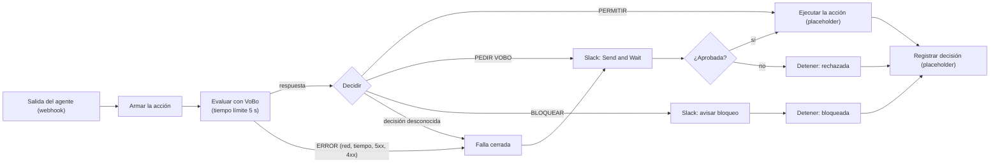

# Compuerta de VoBo para n8n (ejemplo)

`vobo-compuerta.workflow.json` es un flujo **importable en n8n** que pone a VoBo como un paso por el que pasa todo lo que sale hacia afuera. Es un ejemplo: no afirma nada sobre la instancia de n8n, el Slack ni el CRM de 30X. Los nodos «placeholder» se reemplazan por las acciones reales.

**Falla cerrada.** Si la llamada a VoBo falla por cualquier motivo (red caída, tiempo agotado a los 5 s, 5xx, 4xx) o VoBo responde una decisión que el flujo no conoce, la acción va a la rama de **PEDIR VOBO**, nunca a PERMITIR. Solo se ejecuta si una persona la aprueba.

## Cómo usarlo

1. En n8n: **Workflows → Import from file** y elige `vobo-compuerta.workflow.json` (o `n8n import:workflow --input=...`).
2. En el nodo **Evaluar con VoBo**, cambia la URL por la de tu instancia de VoBo (hoy apunta a la demo pública: `https://vobo-jev.vercel.app/api/evaluate`).
3. En los dos nodos de Slack, configura tu **credencial** y el **canal**. Mientras el canal sea el texto de relleno, n8n se niega a ejecutar el flujo: es a propósito, para que no corra a medias.
4. Reemplaza **Ejecutar la acción (placeholder)** por la acción real y el webhook por el disparador real.
5. **Registrar decisión (placeholder)** solo *arma* el registro (`registro` de la respuesta de VoBo y el `resultado`: ejecutada, rechazada o bloqueada). No escribe en ningún sistema.

El webhook de ejemplo recibe un JSON como el del contrato de VoBo (`tipo_accion`, `canal`, `destinatarios`, `hora_envio`, `texto`, y opcionalmente `id`, `segmento_declarado`, `campo_crm`). El nodo **Armar la acción** completa lo que falte con valores por defecto.

## Qué se probó (y qué no)

Probado el 17 de octubre de 2026 en un **n8n 2.43.7 local** (instalado con npm en una carpeta temporal, solo en 127.0.0.1, sin telemetría), con el flujo importado y publicado, llamando al webhook de producción y leyendo después qué nodos corrieron en cada ejecución:

| Prueba | Resultado |
|---|---|
| El archivo se importa | Sí, sin errores. Los parámetros del nodo Send and Wait se contrastaron con el código de n8n (`operation: sendAndWait`, `select`, `channelId`, `approvalOptions`). |
| PERMITIR | Ejecuta la acción y registra la decisión. |
| BLOQUEAR | Avisa, detiene y registra; **no** ejecuta. |
| PEDIR VOBO, la persona aprueba | Ejecuta. |
| PEDIR VOBO, la persona rechaza | Detiene y registra; **no** ejecuta. |
| VoBo caído (conexión rechazada) | Sale por el **error** del HTTP Request → falla cerrada → PEDIR VOBO; **no** ejecuta sin aprobación. |
| VoBo que se cuelga | Corta a los 5 s («timeout of 5000ms exceeded») → falla cerrada → PEDIR VOBO. |
| VoBo que responde 500 | Falla cerrada → PEDIR VOBO. |
| VoBo que responde una decisión desconocida | Sale por la salida de reserva del Switch → falla cerrada → PEDIR VOBO. |
| VoBo caído y una persona aprueba explícitamente | Ejecuta (la aprobación humana explícita es lo único que habilita la ejecución). |

**Cómo se simuló a la persona.** En las copias de prueba, los dos nodos de Slack se sustituyeron por simuladores con el mismo nombre (uno devuelve «aprobada» o «rechazada» según un campo del cuerpo y el otro no hace nada). Eso prueba el **enrutamiento** del flujo.

**Lo que NO se probó:**
- Los nodos de Slack **reales** no se ejecutaron contra Slack (no hay credencial). Sí se comprobó que, con un canal en formato válido, n8n los acepta, el flujo llega hasta ellos y fallan solo porque la credencial no existe. Los **botones reales** de Aprobar y Rechazar, el mensaje en el canal y la espera de la respuesta quedan sin verificar.
- Ninguna otra versión de n8n (el nodo Send and Wait de Slack exige una versión reciente).
- Que el flujo funcione dentro de la instancia de n8n de 30X: no la conocemos.
- La escritura del registro en un CRM (es un placeholder).

## Límites

- Solo pasa por VoBo lo que pasa por este paso: una llamada directa que no pase por el flujo no se evalúa.
- El endpoint de VoBo es público (la demo no tiene clave) y el texto de los mensajes viaja a JEV, un tercero.
- Se evalúa una acción a la vez.

Más contexto, el contrato y los demás límites: [`docs/INTEGRACION.md`](../../docs/INTEGRACION.md).
